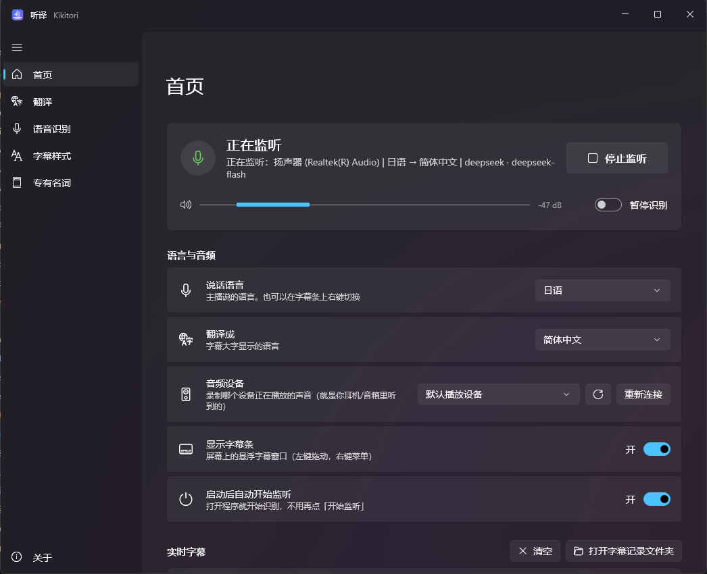

# Kikitori · 听译

**看日 V 直播听不懂？打开听译，电脑里播放的声音会被实时识别、翻译，显示成悬浮字幕。**

> Kikitori is a Windows desktop app that listens to whatever your PC is playing (a Bilibili / YouTube stream, a video, a game…), transcribes speech locally with Whisper on your NVIDIA GPU, translates it with an LLM (DeepSeek, a local Ollama model, or any OpenAI-compatible API), and shows live subtitles in an always-on-top overlay. UI: WinUI 3. License: GPL-3.0.




## 功能

- **什么都能翻**：录的是电脑正在播放的声音（WASAPI 回环），B 站网页、客户端、YouTube、本地视频都能用，不需要麦克风。
- **本地识别，又快又准**：Whisper large-v3 跑在你的显卡上，一句话识别只要约 0.2 秒；说话过程中先显示原文草稿。
- **大模型翻译，懂梗**：默认用 DeepSeek（便宜、懂网络用语和 V 圈梗），也可以用本地 Ollama（免费离线）或任意 OpenAI 兼容接口。
- **多语言**：说话语言支持日语 / 英语 / 韩语 / 中文 / 俄语 / 法语 / 西班牙语 / 德语 / 自动识别；可以翻译成简体中文 / 繁體中文 / English / 日本語 / 한국어。
- **悬浮字幕条**：置顶、半透明、可拖动，高度随内容自动伸缩；右键菜单随时切换语言、字号、条数、不透明度。
- **专有名词表**：主播名、粉丝名、固定梗统一译名，同时提高识别准确率。
- **字幕记录**：每次的原文和译文自动保存成文本。

## 系统要求

- Windows 10 1809 及以上 / Windows 11，64 位
- **NVIDIA 显卡**（建议 RTX 系列、显存 6GB 以上）并安装较新的驱动。没有 N 卡也能用 CPU 运行，但会很慢。
- 磁盘空间：程序约 450MB；首次运行时自动下载显卡运行库（约 1.3GB，解压后约 2GB）和语音识别模型（约 3GB）
- 使用 DeepSeek 等在线翻译时需要联网和对应的 API Key

## 下载和使用

1. 到 [Releases](https://github.com/biubiu223/Kikitori/releases) 下载安装包 `Kikitori-x.y.z-setup.exe` 运行安装（不需要管理员权限）；或者下载免安装版 `Kikitori-x.y.z-win-x64.zip` 解压后双击 `Kikitori.exe`。
2. 第一次运行会自动下载显卡运行库（约 1.3GB）和语音识别模型（约 3GB），首页会显示进度，只需下载一次。
   - 下载源默认「自动」，会自动选择国内镜像或国外官方源中较快的一个；也可以在「语音识别」页手动切换。
3. 在「翻译」页填写 API Key（DeepSeek 在 <https://platform.deepseek.com/api_keys> 申请），点「测试连接」确认可用。Key 用 Windows 账户加密后只保存在本机。
4. 回到「首页」选择说话语言和翻译语言，打开直播即可。

### 字幕条操作

| 操作 | 效果 |
|---|---|
| 左键拖动 | 移动字幕条 |
| 拖右下角 | 调整宽度（高度随内容自动变化） |
| 右键 | 暂停、切换语言、显示/隐藏原文、字号、条数、不透明度、清空、退出 |

- 蓝色带「…」的是正在说的那句的原文草稿；说完一句后换成正式原文和译文。
- 关闭主窗口只会缩到托盘，字幕继续工作；从托盘图标或字幕条右键菜单「退出」才会真正关闭。

### 改用本地翻译（免费、离线）

1. 安装 [Ollama](https://ollama.com)，在命令行运行 `ollama pull qwen3:8b`（约 5GB）。
2. 在「翻译」页把翻译引擎改为「本地 Ollama」。

Whisper 约占 4GB 显存，`qwen3:8b` 约 6GB，16GB 显卡可以同时运行。本地模型对口语和梗的翻译质量比 DeepSeek 差一些。

### 延迟和费用

- 主播说完一句后大约 1～1.5 秒出译文（识别约 0.2 秒 + DeepSeek 翻译约 0.6 秒）。
- DeepSeek 按量计费，按目前价格估算 2 小时直播大约 1 元左右，以官网价格为准。

## 工作原理

```
系统播放的声音 (WASAPI loopback)
   → 重采样 16kHz → Silero VAD 断句
   → faster-whisper (CTranslate2, CUDA) 识别
   → 大模型翻译（带上文和专有名词表）
   → WinUI 3 悬浮字幕条
```

程序分两部分：

- `engine/`（打包后）：Python 写的识别/翻译引擎，无界面，通过 stdin/stdout 的 JSON Lines 和界面通信，协议见 [docs/protocol.md](docs/protocol.md)。
- `Kikitori.exe`：WinUI 3（C#）界面，负责设置、控制和字幕显示。

## 从源码构建

需要：Python 3.11+（开发时用的是 3.14）、.NET 8 SDK、NVIDIA 驱动。**不需要** Visual Studio。

```powershell
# 1. Python 环境：建在仓库根目录（约 1.5GB，主要是 CUDA 运行库）
python -m venv .venv
.venv\Scripts\python.exe -m pip install -r engine\requirements.txt -r engine\requirements-build.txt

# 2. 一键构建：打包引擎 + 发布界面 + 组装到 dist\Kikitori\（加 -Zip 生成免安装压缩包，加 -Installer 生成安装程序）
powershell -ExecutionPolicy Bypass -File build.ps1
```

开发调试时可以不打包引擎：设置环境变量 `KIKITORI_ENGINE` 为 `"<仓库>\.venv\Scripts\python.exe" "<仓库>\engine\engine_server.py"`，再运行 `app\Kikitori` 工程即可。也可以单独运行引擎：`.venv\Scripts\python.exe engine\engine_server.py`（stdin/stdout 收发 JSON Lines）。

### 测试

```powershell
powershell -ExecutionPolicy Bypass -File tools\make_test_audio.ps1                 # 生成测试录音（用 Windows 自带语音）
.venv\Scripts\python.exe tools\test_engine_protocol.py                              # 引擎协议测试（源码模式）
.venv\Scripts\python.exe tools\test_engine_protocol.py --exe --runtime-test         # 打包后的 exe（先用本地镜像装显卡运行库）
powershell -ExecutionPolicy Bypass -File app\tools\ui_test.ps1 -NoMouse             # 界面自动化测试（对接模拟引擎）
```

- `tools/mock_engine.py`：模拟引擎，按协议发假数据，不需要模型和显卡，用来开发界面。
- `tools/mock_llm.py`：模拟的 OpenAI 兼容翻译服务，不需要 API Key。
- 打包后的精简 exe 不带显卡运行库：`--exe` 测试会用本地 HTTP 服务器模拟镜像给它装一份（wheel 缓存在 `build\cuda-wheels\`，第一次会从网上下载约 1.3GB）。

### 目录结构

```
app/                    WinUI 3 界面（C#）
  Kikitori/               工程源码
  tools/                  发布脚本、图标生成、界面自动化测试
engine/                 识别/翻译引擎（Python）
  kikitori/               引擎代码（录音、断句、识别、翻译、显卡运行库下载）
  engine_server.py        引擎进程入口（界面通过 stdin/stdout 和它通信）
  packaging/              PyInstaller 打包配置、显卡运行库清单
  requirements.txt        运行依赖（requirements-build.txt：打包依赖）
installer/              Inno Setup 安装程序脚本
docs/                   界面 ⇄ 引擎通信协议（protocol.md）、截图
tools/                  模拟引擎、模拟翻译服务、测试脚本
build.ps1               一键构建
```

## 许可证

[GPL-3.0](LICENSE)，附加许可允许与 NVIDIA CUDA 运行库、Microsoft Windows App SDK 运行库一起分发。第三方组件及其许可证见 [THIRD-PARTY-NOTICES.md](THIRD-PARTY-NOTICES.md)。

## 致谢

[faster-whisper](https://github.com/SYSTRAN/faster-whisper) · [CTranslate2](https://github.com/OpenNMT/CTranslate2) · [OpenAI Whisper](https://github.com/openai/whisper) · [Silero VAD](https://github.com/snakers4/silero-vad) · [PyAudioWPatch](https://github.com/s0d3s/PyAudioWPatch) · [Windows App SDK](https://github.com/microsoft/WindowsAppSDK) · [WinUIEx](https://github.com/dotMorten/WinUIEx) · [H.NotifyIcon](https://github.com/HavenDV/H.NotifyIcon) · [Windows Community Toolkit](https://github.com/CommunityToolkit/Windows)
